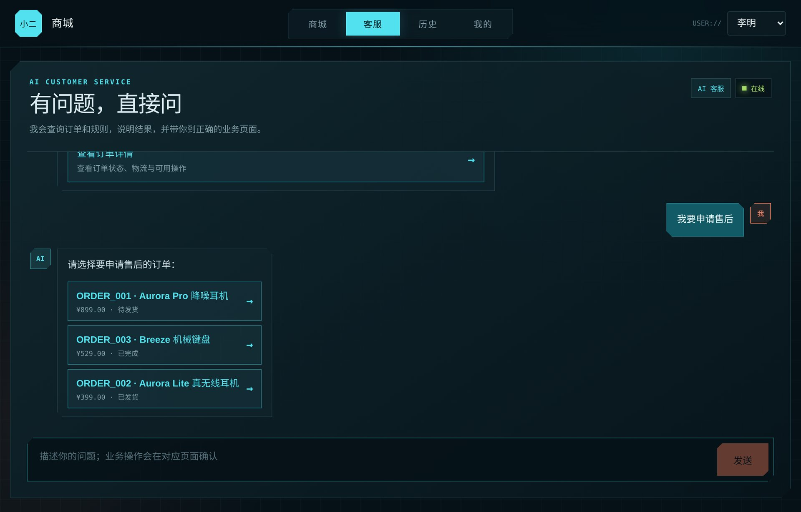
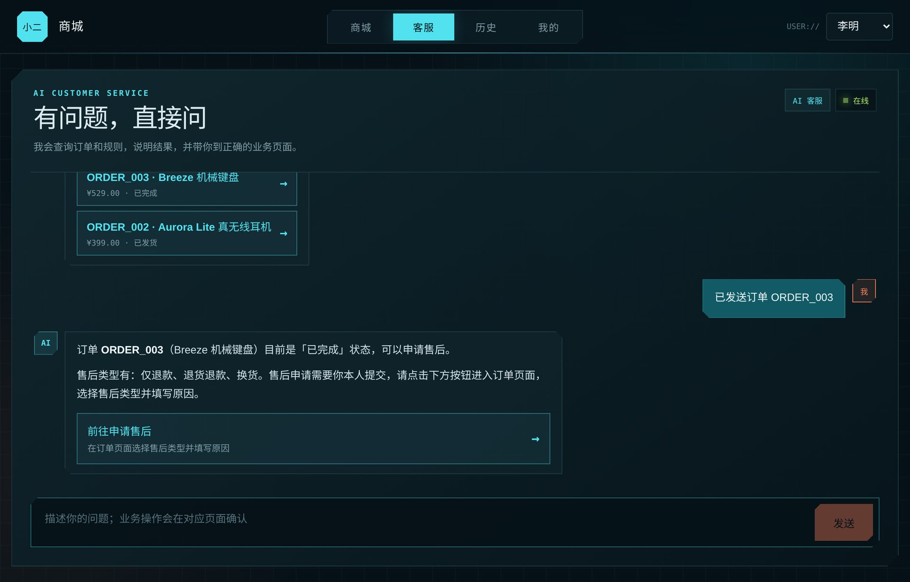
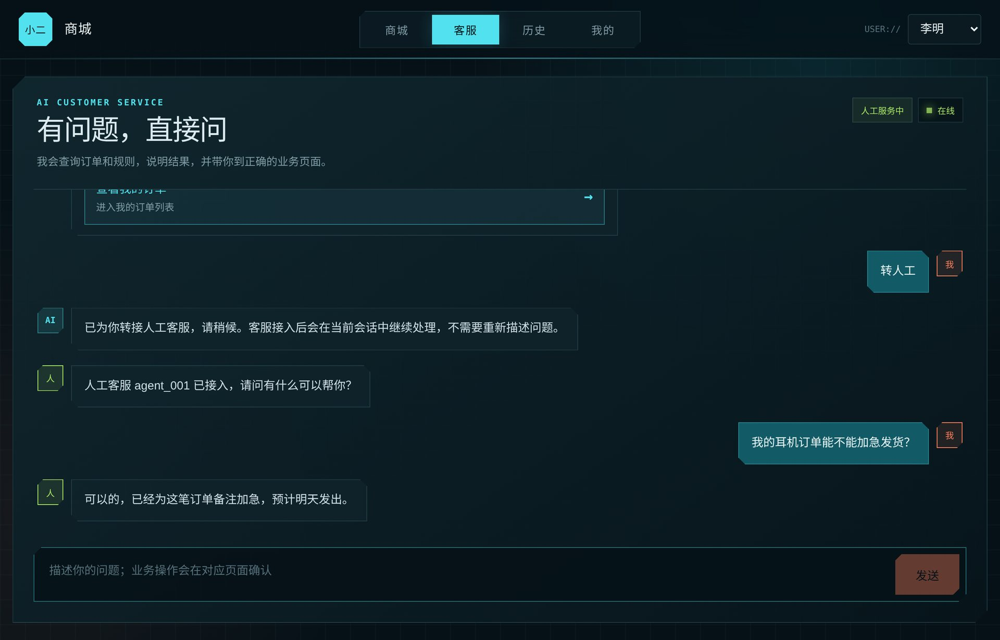
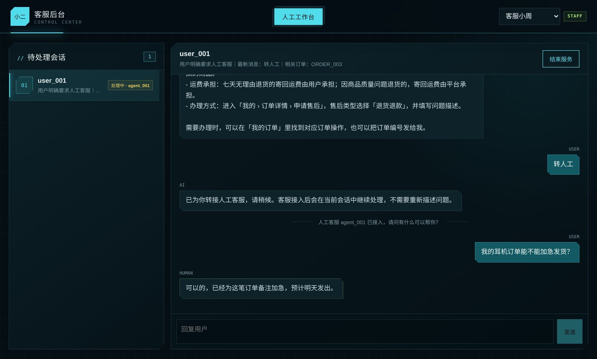
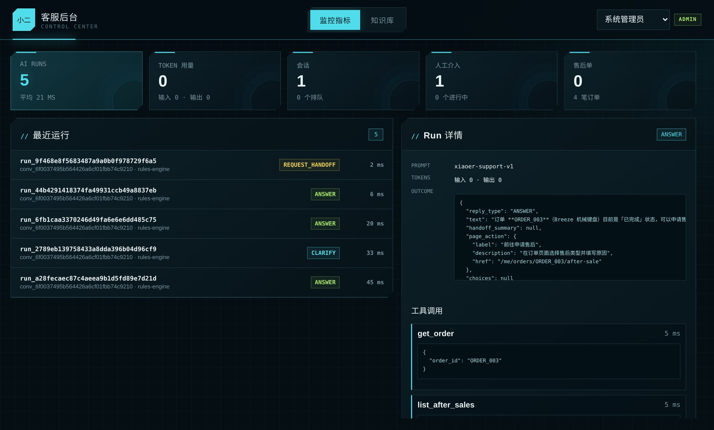
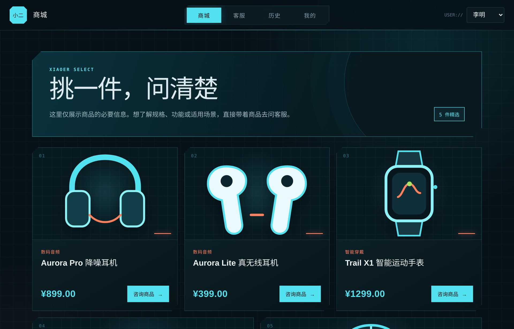
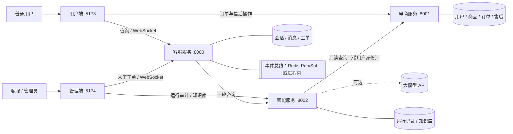

# 电商小二 · 电商智能客服系统

一套可以在本机完整运行的电商智能客服：用户在商城里提问，**AI 客服**基于真实的订单、商品、物流数据和平台规则作答；取消订单、改地址、申请售后这类操作由用户在页面上亲自确认；AI 处理不了的问题转给**人工客服**，在同一个会话里接着聊。

两个 Vue 前端 + 三个 FastAPI 后端，**零外部依赖即可启动**（不需要数据库、Redis、Docker，也不需要大模型 API Key），同一套代码可以切换到 PostgreSQL + Redis 和真实大模型。

| AI 给出候选订单，用户点选 | AI 引导到业务页面，由用户确认 |
|---|---|
|  |  |
| **人工客服在原会话中接管** | **人工工作台：实时收发消息** |
|  |  |
| **每次 AI 运行都可审计** | **商城** |
|  |  |

## 特性

- **回答有依据**：订单、商品、库存、物流、售后一律通过只读工具从电商服务实时查询，平台规则来自知识库检索；回复里的编号、金额、状态在返回前逐项核对，找不到依据就不放行。
- **只读的 AI**：AI 没有任何写接口。需要办理业务时，它给出一个站内页面入口，由用户本人确认、由电商服务校验权限和订单状态。
- **人机协作**：明确要求人工、投诉争议、情绪激动时自动转人工；客服接入的是原会话，能看到完整上下文；结束后交还 AI。
- **连续提问合并**：用户把一个问题拆成几条消息发，只会得到一次完整的回答。
- **大模型可选、可降级**：支持 DeepSeek、通义千问、Ollama 和任意 OpenAI 兼容接口；模型调用失败、超时或回复没通过校验时，自动降级到内置规则引擎。不接大模型也能完整使用。
- **实时推送**：WebSocket + 发件箱模式，事件总线可选 Redis Pub/Sub 或进程内实现。
- **可观测**：每次 AI 运行的结果、耗时、Token 用量和工具调用都有记录，管理端可以逐条查看。
- **一键启动**：启动器负责安装依赖、按顺序拉起五个应用、健康检查，并附带 29 项全链路自检。

## 架构



| 应用 | 目录 | 端口 | 职责 |
|---|---|---:|---|
| 用户端 | `frontend/user-frontend` | 5173 | 商城、订单、客服会话、业务确认页面 |
| 管理端 | `frontend/admin-frontend` | 5174 | 人工工作台、监控指标、知识库 |
| 客服服务 | `customer-service` | 8000 | 会话与消息、连续提问合并、人工工单、实时推送 |
| 电商服务 | `ecommerce-service` | 8001 | 用户、商品、订单、物流、售后 |
| 智能服务 | `ai-service` | 8002 | 理解问题、查询事实与规则、生成并校验回复 |

三个后端各自拥有自己的数据库，跨服务只通过 HTTP 接口访问。

**技术栈**：Python 3.12 · FastAPI · SQLAlchemy 2（异步）· LangChain 1.x · PyJWT · HTTPX · Redis Pub/Sub · PostgreSQL / SQLite · Vue 3 · Vite

---

## 快速开始

**环境要求**：[uv](https://docs.astral.sh/uv/)（会自动准备 Python 3.12）和 Node.js 20.19+ / 22.12+。

**Windows**：双击项目根目录的 **`start.bat`**。

**macOS / Linux**：`./xiaoer.sh start`

第一次运行会下载依赖（几分钟），之后启动器依次启动五个应用、做健康检查，并自动打开浏览器：

- 用户端 <http://127.0.0.1:5173>
- 管理端 <http://127.0.0.1:5174>

保持启动窗口打开；按 `Ctrl+C` 或关闭窗口即停止全部应用。

| 脚本 | 作用 |
|---|---|
| `start.bat` | 零依赖模式启动（SQLite + 进程内事件总线） |
| `start-docker.bat` | 标准部署模式启动（PostgreSQL + Redis，由 Docker 运行） |
| `stop.bat` | 停止应用 |
| `test.bat` | 全链路自检（29 项，需要应用处于运行状态） |
| `reset.bat` | 清空本地数据，恢复初始演示数据 |

常用参数（跟在 `start.bat` 后面）：`--mirror` 用国内镜像安装 Python 依赖；`--skip-install` 跳过依赖检查；`--no-browser` 不自动打开浏览器。

**演示账号**（页面右上角切换，无需密码）

| 端 | 账号 | 能做什么 |
|---|---|---|
| 用户端 | 李明 `user_001`、王芳 `user_002` | 逛商城、查订单、咨询客服、取消订单 / 改地址 / 申请售后 |
| 管理端 | 客服小周 `agent_001` | 人工工作台：查看工单、接入、回复、结束服务 |
| 管理端 | 系统管理员 `admin_001` | 监控指标、AI 运行审计、知识库上传 |

---

## 五分钟体验

1. **AI 咨询**：用户端「客服」页，点击「我的订单什么时候发货？」。AI 查到李明唯一一笔待发货订单，说明状态并引用平台的发货时效规则。
2. **澄清选择**：输入「我要申请售后」。有多笔订单符合条件，AI 给出订单卡片；点选其中一笔后，AI 根据订单状态给出「前往申请售后」的入口。
3. **用户确认**：点击入口进入售后页面，自己填写并提交 —— AI 只负责引导，写操作由用户在页面完成、由电商服务校验。
4. **平台规则**：输入「七天无理由退货运费谁出」「发票怎么开」，答案来自知识库。
5. **商品咨询**：在「商城」点任意商品的「咨询商品」，或直接问「耳机有货吗」。
6. **转人工**：输入「转人工」，右上角状态变为「等待人工」。
7. **人工接管**：打开管理端，账号切换为「客服小周」，在队列里打开会话 → 「接入会话」→ 回复。用户端实时收到消息；用户再发的消息也实时出现在工作台。点「结束服务」后会话交还 AI。
8. **运行审计**：管理端切换为「系统管理员」，「监控指标」里可以看到每次 AI 运行的结果类型、耗时，以及它调用了哪些只读工具。
9. **知识库**：「知识库」页上传 `docs/samples/会员与优惠券规则.pdf`，然后回到用户端问「积分规则是什么」。

---

## 接入大模型（可选）

不配置大模型时，智能服务使用**内置规则引擎**：同样会查询真实业务数据和知识库，只是理解能力限于常见说法。

要启用大模型，编辑 `ai-service/.env`（首次启动时由 `.env.example` 自动生成）后重启：

```ini
# DeepSeek
LLM_PROVIDER=deepseek
LLM_BASE_URL=https://api.deepseek.com
LLM_MODEL=deepseek-flash
LLM_API_KEY=你的 Key
```

`.env` 里还有通义千问（`qwen`）、本机 Ollama（`ollama`，不需要 Key）和任意 OpenAI 兼容接口（`openai`）的示例。模型需要支持工具调用（Function Calling）。

启用后，启动窗口和 <http://127.0.0.1:8002/health> 会显示当前模型；管理端「最近运行」里每条记录也标明了由哪个引擎完成。

大模型不是单点：**调用失败、超时（默认 55 秒）或回复两次没有通过校验时，自动降级到规则引擎**，用户仍然能得到有依据的回复。此时运行记录显示为 `模型名 → rules-engine`。

> `.env` 可能含有你的 API Key，已被 `.gitignore` 排除，不会被提交。

---

## 使用 PostgreSQL + Redis

零依赖模式和标准部署模式跑的是**同一套代码**，只是连接串不同。

**方式一：Docker**。启动 Docker 后运行 `start-docker.bat`（或 `./xiaoer.sh start --docker`）。它会用 `deploy/compose.yml` 启动 PostgreSQL（pgvector）和 Redis，并把连接串注入三个后端。

**方式二：已有的数据库**。把三个后端 `.env` 里的连接串改成对应地址，再用 `start.bat` 启动：

| 文件 | 变量 | 示例 |
|---|---|---|
| `ecommerce-service/.env` | `ECOM_DATABASE_URL` | `postgresql+psycopg://用户:密码@主机:5432/ecommerce` |
| `customer-service/.env` | `DATABASE_URL` | `postgresql+psycopg://用户:密码@主机:5432/customer_service` |
| `customer-service/.env` | `REDIS_URL` | `redis://主机:6379/0` |
| `ai-service/.env` | `AI_DATABASE_URL` | `postgresql+psycopg://用户:密码@主机:5432/ai_customer_service` |

三个库由 `deploy/postgres/init.sql` 创建；表在各服务首次启动时自动建立。`/health` 会显示当前实际使用的数据库与事件总线。

---

## 工作原理

### 一条消息的旅程

```
用户发送消息
  → 客服服务保存消息（按 message_id 去重）
  → 会话当前由谁接待？
      ├─ 人工（排队 / 服务中）→ 实时推给管理端，AI 不参与
      └─ AI → 进入「轮次」，等待约 1 秒合并用户连续发来的几条消息
              → AI Worker 领取轮次，带着「本轮消息 + 最近 30 条历史」调用智能服务
              → 智能服务返回结果 → 客服服务保存回复
              → 写入发件箱 → 事件总线 → WebSocket 推给用户端
```

- **连续提问合并**：先发「我的订单」再发「什么时候发货」，只会得到一次回答。AI 处理期间用户又补充了内容时，当前结果作废，合并后重新回答。
- **发件箱模式**：实时事件和业务数据在同一个事务里落库，再由后台 Worker 发布，推送失败会重试，不会丢消息；历史消息始终以数据库为准。
- **失败降级**：智能服务不可用时重试一次；仍失败则提示用户稍后再试，如果用户说的是「转人工」，直接创建人工工单。

### 智能服务的回答流程

```
前置分析（意图、指向的订单 / 商品、是否需要人工）
  ├─ 明确要人工 / 投诉争议 / 情绪激动 → 请求转人工，附带给客服看的摘要
  └─ 其他 → 回答引擎
            ├─ 大模型（LangChain Agent + 7 个只读工具）
            └─ 规则引擎（未配置大模型时的主引擎，也是降级方案）
        → 校验器 → 保存运行记录 → 返回客服服务
```

结果有四种类型：`ANSWER` 直接回答、`CLARIFY` 请用户补充或选择、`DECLINE` 超出职责或无法确认、`REQUEST_HANDOFF` 请求人工接管。

### 让回答受真实数据约束

| 要求 | 做法 |
|---|---|
| 业务事实来自电商服务 | AI 只能通过只读工具获取订单、商品、物流、售后数据；平台规则来自知识库检索 |
| 不能读别人的订单 | 查询时携带**当前用户的令牌**，数据范围由电商服务判定；查不到和无权限对用户的说法一致 |
| 不能编造 | 校验器检查回复里的订单 / 商品 / 售后编号、金额与数量、订单与物流状态，必须能在本次工具结果中找到依据 |
| 不能替用户操作 | AI 没有任何写接口；回复里出现「已为您取消 / 稍后为您办理」之类的说法会被校验器拒绝 |
| 只能引导到正确的页面 | 页面动作是服务端白名单；引用的订单必须经 `get_order` 确认，且订单状态允许该操作（已发货的订单不会给出「取消」入口） |
| 查询失败要降级 | 业务工具全部失败时，统一回复「暂时无法确认」，不会基于失败的查询作答 |

大模型的回复没通过校验时，校验原因会反馈给模型重答一次；仍不通过则交给规则引擎。

### 人工转接

AI 请求转人工 → 客服服务创建待处理工单，会话进入「排队」→ 管理端实时收到通知 → 客服接入（同一工单只有第一个接入的人成功）→ 客服看到**原会话的全部消息**并回复 → 结束服务后会话回到 AI。整个过程用户都在同一个会话里，不需要重新描述问题。

### 访问权限

登录令牌由电商服务签发（演示账号），三个后端共用同一个 `JWT_SECRET` 校验。

| 角色 | 可以访问 |
|---|---|
| `user` | 自己的订单与售后、自己的客服会话 |
| `staff` | 人工工单的查看、接入、回复、结束 |
| `admin` | 三个服务的运行指标、AI 运行审计、知识库 |

智能服务的 `/internal/v1/agent/runs` 只接受客服服务的调用（需要内部服务令牌 + 用户令牌）。

---

## 目录结构

```text
.
├─ start.bat / start-docker.bat / stop.bat / test.bat / reset.bat
├─ xiaoer.bat · xiaoer.sh          启动器入口
├─ scripts/
│  ├─ xiaoer.py                    启动器：安装依赖、启动与监控五个应用
│  └─ smoke_test.py                全链路自检
├─ deploy/
│  ├─ compose.yml                  PostgreSQL + Redis
│  └─ postgres/init.sql            创建三个数据库
├─ docs/                           截图与知识库示例文档
├─ customer-service/
│  └─ customer_service/
│     ├─ app.py · main.py · settings.py
│     ├─ models.py                 会话、消息、轮次、发件箱、工单
│     ├─ bus.py                    事件总线：Redis Pub/Sub / 进程内
│     ├─ services/                 chat（对话主流程）· handoff（人工工单）· realtime（发件箱）
│     ├─ workers/                  ai（调用智能服务）· realtime（发布实时事件）
│     └─ routers/                  chat · handoff · realtime（WebSocket）
├─ ai-service/
│  ├─ ai_service/
│  │  ├─ app.py · main.py · settings.py · models.py
│  │  ├─ agent/
│  │  │  ├─ analysis.py            前置分析：意图、订单指代、转人工识别
│  │  │  ├─ toolbox.py             只读工具 + 调用审计
│  │  │  ├─ llm_engine.py          LangChain Agent（DeepSeek / 通义 / Ollama / OpenAI 兼容）
│  │  │  ├─ rule_engine.py         规则引擎
│  │  │  ├─ validator.py           事实校验、只读约束、页面动作白名单
│  │  │  ├─ catalog.py             页面动作与订单状态规则
│  │  │  └─ executor.py            一次运行的编排与降级
│  │  ├─ services/                 knowledge（切片与检索）· admin（运行观测）
│  │  ├─ knowledge/platform_rules.md   内置平台规则（知识库初始内容）
│  │  └─ routers/                  run（内部接口）· admin（指标 / 审计 / 知识库）
│  └─ tests/                       单元测试
├─ ecommerce-service/
│  └─ ecommerce_service/           商品、订单、物流、售后接口与演示数据
└─ frontend/
   ├─ user-frontend/               用户端（Vue 3 + Vite）
   └─ admin-frontend/              管理端（Vue 3 + Vite）
```

---

## 接口一览

三个后端都提供 Swagger 文档：`http://127.0.0.1:8000/docs`（8001、8002 同理）。

**客服服务 :8000**

| 方法 | 路径 | 角色 | 说明 |
|---|---|---|---|
| POST | `/api/v1/chat/messages` | user | 发送消息（文字，或订单 / 商品卡片） |
| GET | `/api/v1/chat/history` | user | 当前会话与历史消息 |
| WS | `/api/v1/realtime` | 全部 | 实时通道；连接后先发 `{"type":"authenticate","token":"…"}` |
| GET | `/api/v1/handoffs` | staff | 待处理与处理中的工单 |
| GET | `/api/v1/handoffs/{id}/messages` | staff | 工单对应会话的全部消息 |
| POST | `/api/v1/handoffs/{id}/accept` | staff | 接入（已被接入时返回 409） |
| POST | `/api/v1/handoffs/{id}/messages` | staff | 回复用户 |
| POST | `/api/v1/handoffs/{id}/resolve` | staff | 结束人工服务 |
| GET | `/api/v1/admin/metrics` | admin | 会话与人工介入指标 |

**智能服务 :8002**

| 方法 | 路径 | 角色 | 说明 |
|---|---|---|---|
| POST | `/internal/v1/agent/runs` | 内部令牌 + user | 处理一轮咨询 |
| GET | `/api/v1/admin/metrics` | admin | AI 运行次数、平均耗时、Token 用量 |
| GET | `/api/v1/runs`、`/api/v1/runs/{id}` | admin | 运行列表；单次运行的结果与工具调用 |
| GET | `/api/v1/knowledge` | admin | 知识切片列表 |
| POST | `/api/v1/knowledge/upload` | admin | 上传规则文档（PDF；同名文件视为更新） |
| DELETE | `/api/v1/knowledge/{file_name}` | admin | 删除一份文档的全部切片 |

**电商服务 :8001**：登录（`/api/v1/auth/demo-token`）、商品、订单、物流、取消订单、修改地址、售后、汇总，详见 `/docs`。

---

## 知识库

- 首次启动时自动写入内置规则 `ai_service/knowledge/platform_rules.md`（售后、七天无理由、退款时效、取消与改地址、发货、运费、发票等 13 个切片）。
- 上传的文档按「标题 → 段落」切片入库。默认用关键词相关度（BM25）检索，不依赖外部服务。
- 如需向量检索：在 `ai-service/.env` 里配置 `EMBEDDING_BASE_URL / EMBEDDING_API_KEY / EMBEDDING_MODEL`（OpenAI 兼容的 `/embeddings` 接口），之后上传的文档会写入向量，检索时做「关键词 + 向量」混合排序。
- 扫描件 / 图片 PDF 提取不到文字，上传时会给出明确提示。

---

## 开发与测试

```bash
# 全链路自检（应用需处于运行状态）
python scripts/xiaoer.py test

# 智能服务单元测试：意图识别、结果校验、知识检索
cd ai-service && uv run --group dev pytest

# 只启动某一个后端（在对应目录下）
uv run python -m customer_service.main
```

运行日志在 `logs/`；本地数据在各后端的 `data/`（SQLite 文件）。

---

## 常见问题

**端口被占用**：启动器会指出是哪个端口。先运行 `stop.bat`；如果是其他程序占用了 8000 / 8001 / 8002 / 5173 / 5174，需要先关掉它。

**依赖下载很慢**：`start.bat --mirror` 改用国内镜像安装 Python 依赖。

**`start-docker.bat` 拉不下镜像**：给 Docker 配置镜像加速，或先手动 `docker pull pgvector/pgvector:pg16` 与 `redis:7.4-alpine`。

**AI 回复「AI 客服暂时不可用」**：智能服务没有启动或启动失败，查看 `logs/ai-service.log`。

**配置了大模型但运行记录显示 `→ rules-engine`**：模型调用失败或超时后降级了，`logs/ai-service.log` 里有具体原因（常见：Key 无效、模型名写错、模型不支持工具调用）。

**想从头再来**：`stop.bat` 之后运行 `reset.bat`。

---

## 功能边界

已实现：商品与订单查询、取消订单、修改地址、申请售后、AI 咨询、人工转接、运行观测、知识库管理。

暂未实现：购物车、下单支付、真实发货、售后审批与退款、正式的账号注册与密码登录。演示账号无需密码，`JWT_SECRET` 等均为演示值，**请勿直接用于生产环境**。
